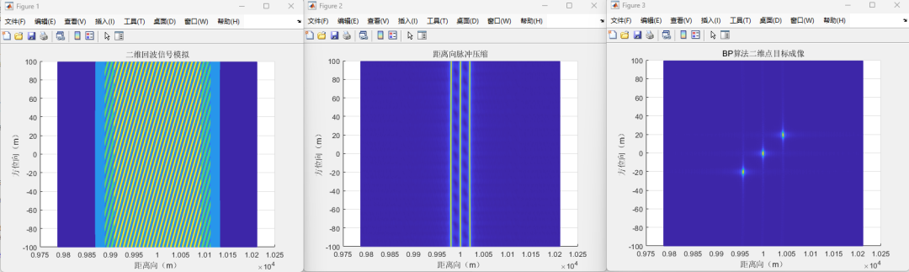

# [SAR Imaging]Principle Analysis of Back Projection (BPA) Algorithm in Beamforming Mode[with MATLAB Code]

1. Core Parameter Set's Physical Meaning
1.1 The core physical parameters for radar imaging are defined at the beginning of the radar system basic parameter code, serving as the foundation for simulating the real radar operational state:
• 
Light Speed (c = 3e8 m/s): As a benchmark for the propagation speed of electromagnetic waves, it is a key constant for calculating distance and time delay conversion;
• 
Carrier Frequency (f₀ = 5e9 Hz): Determines the wavelength of the radar signal (λ = c/f₀), which directly affects the azimuth resolution and phase calculation accuracy;
• 
Pulse Bandwidth (Br = 200e6 Hz): The wider the bandwidth, the higher the azimuth resolution (theoretical resolution is c/(2Br)), and in subsequent codes, this parameter is used to derive the azimuth sampling rate (fs = 1.6Br) to ensure compliance with the Nyquist sampling theorem;
• 
Modulation Slope (kr = Br/Tp): Tp is the pulse width (1.5e-6 s), kr determines the frequency variation rate of linearly modulated (LFM) signals, being a core parameter for pulse compression.
2. Platform and Imaging Area Parameters
• 
Aircraft Movement Parameters: Set the flight height H = 200 m, velocity v = 100 m/s, total flight distance rm = 200 m, calculate the total time of azimuth movement Lt = rm/v to provide a basis for deriving the number of azimuth sampling points (Nm);
• 
Imaging Area Definition: Centered at (x₀=10000 m, 0), define an imaging range x∈[9900,10100] m, y∈[-100,100] m, R₀ = √(H²+x₀²) as the shortest perpendicular distance from the radar to the imaging center, which is the basis for calculating the azimuth modulation slope (ka = 2v²/(λR₀)), ka determines the frequency variation characteristics of the azimuth signal.
II. Principles and Implementation Logic of Backscatter Simulation
1. Point target modeling sets three discrete point targets A (x₀,0,0), B (x₀+20,20,0), and C (x₀-20,-20,0) to simulate the distribution of real-world targets. The reflection signals from each point target will serve as the basic building blocks for the echo signal.
2. The dynamic slant range radar is mounted on a moving aircraft, with its position varying over time as [0, y_air (mm), H] (where y_air = v・tm - rm/2, tm being the azimuth sampling time). For each azimuth sampling moment (mm), calculate the real-time slant range between the radar and each point target:
•  
Parallel distance formula: Rta = √(A₁² + (A₂ - y_air (mm))² + H²) (Taking A as an example), this formula is based on the three-dimensional space two-point distance formula, reflecting the dynamic position relationship between the radar and the target during its motion.
•  
Physical significance: The slant range varies with the radar's azimuth movement, leading to time delay and phase change in the echo signal. This is the core information source for subsequent imaging.
3. Backscatter signal modulation Each point target's backscatter signal is generated by LFM signal modulation, formula:
recorda = rectpuls(tk-2Rta/c, Tp) · exp(1jπkr(tk-2Rta/c)²) · exp(-1j4πf₀Rta/c)  
•  
Time window function (rectpuls): Limits the signal's validity within the pulse width Tp, simulating the pulse emission characteristics of real radars, where "tk-2Rta/c" indicates the bidirectional time delay of the echo relative to the transmission moment (2Rta/c is the signal round trip time).
•  
Frequency Modulation Phase (exp(1jπkr²)): This term generates the frequency modulation characteristic of LFM signals, reflecting the linear change in signal frequency over time;
Carrier Phase (exp(-1j4πf₀Rta/c)): This term contains phase information about the range Rta, with 4πRta/λ (λ = c/f₀) representing the phase change for the signal's round trip. It is a key encoding of target position.
The echoes from three point targets are then summed to obtain a two-dimensional echo matrix (echo (Nm, Nk)), where Nm is the number of samples along the azimuth direction and Nk is the number of samples along the range direction.
III. Principles of Pulse Compression and Range Up-sampling
1. The core purpose of pulse compression is to ensure high energy while maintaining low range resolution when transmitting LFM signals. By filtering in the frequency domain, wide pulses are compressed into narrow ones, achieving "high energy - high resolution" balancing.
2. Frequency domain filtering implementation process•
Range-Dominant Filter Design: Hkf = (|fk| < Br/2)・exp(1jπfk²/kr), where "|fk| < Br/2" limits the filter bandwidth to match the signal bandwidth, and "exp(1jπfk²/kr)" is a phase compensation term used to cancel the frequency modulation phase of the LFM signal, achieving pulse compression;
•
Column-wise filtering: For each azimuth moment's range-dominant echo (echo (mm,:)), perform FFT transformation to the frequency domain, multiply by Hkf, and then return to the time domain through IFFT to obtain the compressed signal (p_echo).
3. Range up-sampling•
Purpose: To improve the precision of range sampling and reduce the grid error in subsequent BP algorithm imaging;
•
Implementation method: Through zero-padding operation (n_up=10 times up-sampling), insert (Nk_up-Nk) zero values near the 0 frequency in the frequency domain, extending the number of range-dominant sampling points from Nk to Nk_up=Nk×n_up;
Physical Principle: The time interval after up-sampling, tk_up = 1/(fs×n_up), where n_up is the multiple of distance resolution improvement. This provides a foundation for the fine division of subsequent imaging grids.

IV. Backward Projection (BP) Algorithm Main Principle:
The BP algorithm is the core of beamforming radar imaging, which essentially involves "backward projection of time-domain echo energy onto spatial grids". It achieves target imaging by accumulating energy at each point in sequence. The code is divided into three steps: "Imaging Grid Division - Slant Range and Delay Calculation - Energy Projection Accumulation".
1. Fine Division of Imaging Grids:
Grid resolution is based on the radar resolution formula setting the grid step size, dk = p_k/5 (p_k = c/(2Br) is the theoretical distance resolution), and dm = p_m/5 (p_m = λ/(4×0.03), with 0.03 being the main lobe width coefficient), ensuring that the grid precision exceeds the imaging resolution.
2. Two-dimensional Grid Construction:
Generate the distance grid X (corresponding to real horizontal distance) and the azimuth grid Y (corresponding to the radar movement direction), and expand them into a two-dimensional matrix (Nm×Nk), where each grid point represents an uncalculated pixel in the imaging area.
3. Matching Slant Range and Time Delay For each azimuth sampling moment (mm), calculate the slant range Rij = √(X (i,j)² + (Y (i,j) - y_air (mm))²) for each pixel point (i,j) in the imaging grid, and convert it to a double-way time delay tr_ij = 2Rij/c;
4. Index Matching:
Convert the time delay tr_ij to a distance-upsampled signal index t_ij by rounding ((tr_ij - t_min)/tk_up), ensuring each grid point corresponds to the most matching sampling point in the echo signal.
Validity handling: For indices (t_ij) that are out of the signal range (t_ij <= 0 or t_ij > Nk_up), they are mapped to the rightmost index to avoid calculation errors.
3. Energy projection and phase compensation
Energy accumulation: The signal amplitude corresponding to index t_ij in the echo at the current time is extracted (row (t_ij)) and added to the imaging grid point (i,j);
•
Phase compensation: Multiply by the phase term exp(1j4πRij/λ) to compensate for the propagation phase of the signal from the grid point to the radar, ensuring that the echo energy at different time instances on the grid points are coherently superimposed, improving imaging contrast;
•
Imaging output: After traversing all time instances, the amplitude value (abs (images)) of each grid point in the imaging matrix (images) represents the target reflection intensity at that location, which is displayed as a three-dimensional plot of two-dimensional point targets' spatial distribution.
5. Core advantages and physical nature of the algorithm
High precision imaging: Through fine grid division and phase compensation, the BP algorithm can achieve subwavelength level of imaging accuracy, especially suitable for near-field high resolution imaging scenarios in the collimated mode;
2
Direct physical meaning: Based directly on the "backscatter energy reverse projection" physical process, without complex approximation assumptions, it has strong robustness against radar motion errors;
3
Computation complexity: Using a point-by-point accumulation method, the computational load increases linearly with the size of the imaging grid (O (Nm×Nk)), and the code uses the tic/toc function to count the main loop time, providing a basis for algorithm efficiency optimization.

## Images

<!-- PAYMENT_BLOCK -->

## Get this dataset

- Payment link (Stripe): [Buy now](https://buy.stripe.com/3cs8yP7sY87d0vu9AB)
- Payment QR code: 

<!-- /PAYMENT_BLOCK -->
